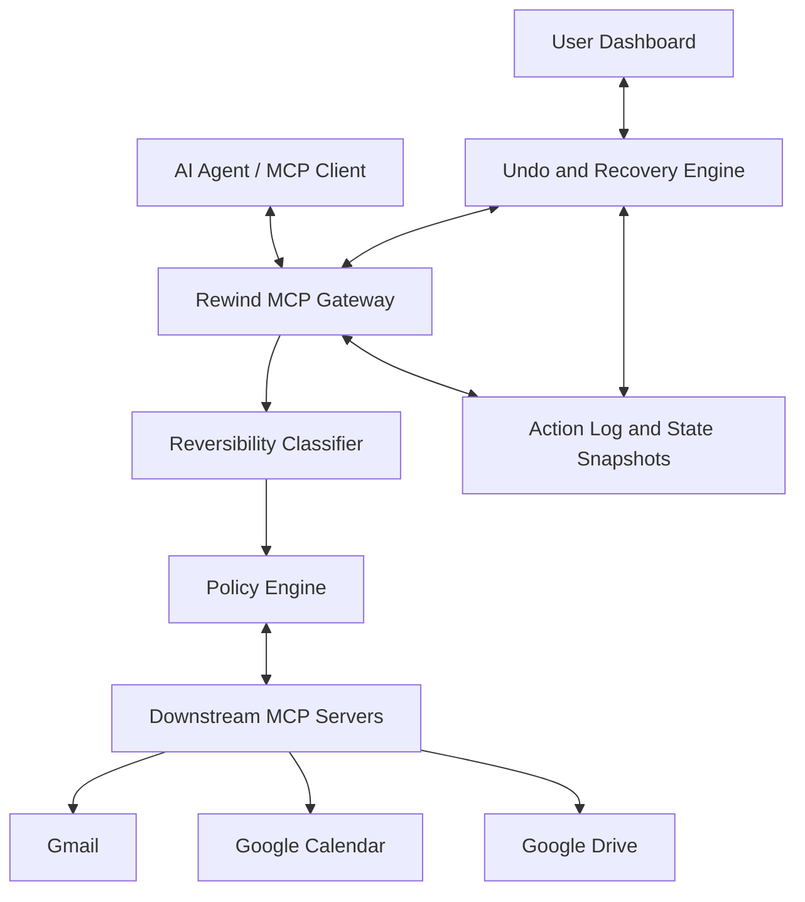

# Rewind — Ctrl+Z for AI Agents

> Giving AI agents autonomy without taking away human control.

## Overview

Rewind is an MCP-native safety and recovery gateway designed to make AI agent actions traceable, controllable and reversible.

It enables users to review, selectively undo and roll back supported agent actions across multiple applications through a unified interface.

## Problem

Autonomous AI agents perform real-world actions such as sending emails, modifying calendar events and deleting files. When something goes wrong, recovering from these actions is difficult.

Traditional approval-based mechanisms limit autonomy, introduce approval fatigue and provide limited post-execution recovery.

## Proposed Solution

Rewind introduces a middleware layer between AI agents and MCP servers that intercepts tool calls, captures application state and manages recovery through tool-specific reversibility contracts.

## Key Features

- **MCP Gateway:** Intercepts and manages agent tool calls.
- **Reversibility Classification:** Classifies actions as read-only, reversible, holdable or irreversible.
- **Selective Undo:** Reverses individual supported actions without rolling back the entire workflow.
- **Session Rewind:** Rolls back supported actions across multiple applications.
- **Conflict Detection:** Identifies subsequent modifications before restoring state.
- **Undo Window:** Delays selected irreversible actions, allowing cancellation before execution.
- **Activity Timeline:** Provides action history, before-and-after comparisons and recovery controls.
- **Audit Trail:** Maintains a tamper-evident record of execution and recovery operations.

## System Architecture

## Proposed Technology Stack

| Component | Technology |
|---|---|
| Frontend | Next.js, React |
| Backend | Python, FastAPI |
| MCP Gateway | FastMCP |
| Database | SQLite |
| Recovery Contracts | YAML, Pydantic |
| Task Scheduling | APScheduler |
| Integrations | Google Workspace APIs |

## Differentiation

Rewind focuses on selective, conflict-aware recovery of completed agent workflows rather than relying solely on pre-execution approvals or failure-triggered rollback.

Its goal is to provide a unified recovery experience across MCP-connected applications while protecting subsequent human modifications.

Recovery is subject to downstream API capabilities. Irreversible actions are explicitly identified rather than falsely presented as recoverable.

## Project Roadmap

- [ ] MCP gateway and tool interception
- [ ] Reversibility registry and action logging
- [ ] Cross-application integrations
- [ ] Selective undo and session rollback
- [ ] Conflict detection and deferred execution
- [ ] Interactive recovery dashboard
- [ ] End-to-end testing and validation

## Hackathon

| | |
|---|---|
| Event | wHACKiest 2026 |
| Track | 01 — Agentic AI |
| Project | Rewind |
| Status | Pre-event proposal |

This repository documents the proposed solution and architecture. Implementation is planned for the official hackathon development phase.

---

**Agents shouldn't need permission for everything. They need a way back.**
